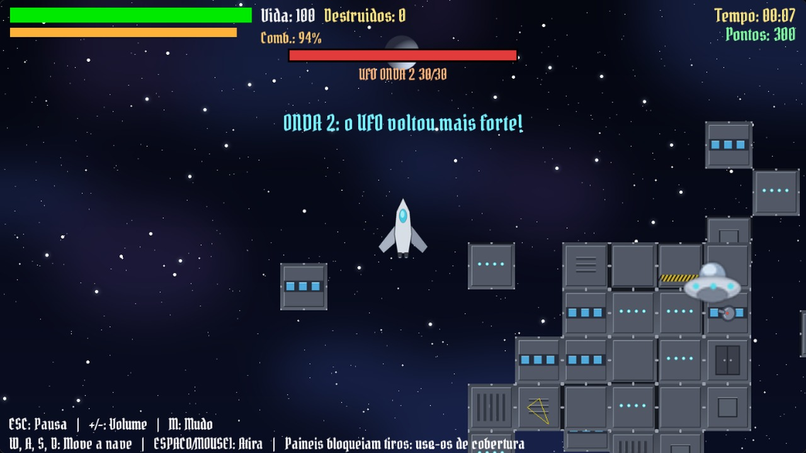

# Lokuras no Espaço



Jogo 2D em **C++ com SDL 1.2**, desenvolvido para a disciplina **Introdução ao Desenvolvimento de Jogos (IDJ)** da Universidade de Brasília (UnB/CIC, Turma A, 2013 — Profª. Carla Denise Castanho).

Este repositório reconstrói todo o **fluxo de desenvolvimento da disciplina** em um histórico Git linear: cada entrega (trabalho **TR** ou exercício **EX**) virou um commit, partindo do game loop básico (TR01) até a game engine completa com máquina de estados (TR04), que dá origem ao jogo **Lokuras no Espaço**.

## O jogo

Você pilota a nave **Hyperion**, perdida no espaço e caçada por alienígenas. Sua única esperança é voltar para a **Terra** — mas o caminho é cheio de planetas vermelhos e um UFO teimosamente em seu encalço.

- **Objetivo:** alcançar a Terra sem ser capturado pelo UFO.
- **Planetas vermelhos** aparecem pela tela (spawn controlado por cooldown); colidir custa **5 de vida** (a nave começa com **100**, mostrada em uma barra no HUD).
- **UFO:** segue uma **fila de comandos de posição** (com as "queue lines" desenhadas no caminho). Se ele alcançar a nave, é derrota na hora.
- **Explosão:** ao colidir com planetas ou UFO, uma animação de explosão (BoomSheet) e som de efeito são disparados.
- **Câmera** centralizada na nave.

### Controles

| Entrada | Ação |
| --- | --- |
| `ENTER` | Iniciar o jogo (menu) / jogar de novo (vitória ou derrota) |
| `W` / `S` | Acelerar / frear a nave (movimento acelerado com atrito) |
| `A` / `D` | Rotacionar a nave |
| `Mouse 1` (esquerdo) | Criar um planeta vermelho em posição aleatória |
| `Mouse 3` (direito) | Enfileirar uma posição para o UFO se mover até lá |
| `Alt+Enter` | Alternar entre janela e tela cheia (em qualquer estado) |
| Fechar a janela | Sair do jogo |

A janela inicia em **1280×720** (16:9). O `Alt+Enter` alterna para tela cheia e volta para a janela sem reiniciar o jogo.

### Estados

`StateMenu` (título, créditos e música) → `StateGame` (jogabilidade) → `StateWinLose` (tela de vitória ou derrota).

Cada estado tem música tema; o estado de jogo tem `stateGame.ogg` e o SFX `boom.wav`.

## Como compilar e executar

O mesmo `src/` compila para Windows (`build.bat`/`run.bat`) e para Linux (`build.sh`/`run.sh`), a partir da raiz do projeto.

### Windows

**Requisitos**

- Windows 10+;
- MinGW-w64 **i686** (msvcrt, posix) com `g++` — ou deixe o `build.bat` baixar automaticamente (veja abaixo).

As bibliotecas **SDL 1.2 + SDL_image + SDL_gfx + SDL_ttf + SDL_mixer** (headers e libs de importação do MinGW) já estão versionadas no próprio repositório, em `lib/` — não é preciso instalar o SDL para compilar no Windows.

O script `build.bat` gera `bin\game.exe` e resolve o compilador em cascata: variável de ambiente `MINGW` → `tools\mingw32` → `PATH`. Se o `g++` não for encontrado, ele chama `tools/setup-mingw.ps1`, que **oferece baixar o toolchain winlibs i686** (GCC 16.2.0, msvcrt, ~270 MB): download com retomada, verificação de **SHA-256** e extração em `tools\mingw32` — tudo dentro da pasta do projeto (apagar o projeto remove também o toolchain baixado).

Para usar um MinGW já existente, defina a variável de ambiente `MINGW`:

```bat
set MINGW=<caminho>\mingw32\bin
```

A linha de compilação usada é, resumidamente:

```bat
g++ -std=gnu++11 -O2 -w -Dmain=SDL_main -I"lib\include" -I"lib\include\SDL" -I"src" ^
  src\AccObject.cpp src\Animation.cpp src\Audio.cpp src\Camera.cpp src\Earth.cpp ^
  src\FollowerObject.cpp src\GameObject.cpp src\HUD.cpp src\InputManager.cpp src\main.cpp ^
  src\Moon.cpp src\Planet.cpp src\PlanetRed.cpp src\Point.cpp src\SDLBase.cpp ^
  src\Sprite.cpp src\StateGame.cpp src\StateManager.cpp src\StateMenu.cpp ^
  src\StateWinLose.cpp src\Text.cpp src\TileMap.cpp src\TileSet.cpp src\Timer.cpp ^
  -o bin\game.exe ^
  -mwindows -L"lib\lib" -lmingw32 -lSDLmain -lSDL_gfx -lSDL_image -lSDL_ttf -lSDL_mixer -lSDL ^
  -static-libgcc -static-libstdc++
```

As DLLs de runtime necessárias estão versionadas em `bin/` (SDL.dll, SDL_image.dll, SDL_ttf.dll, SDL_mixer.dll e dependências como `libpng15-15`, `zlib1`, `libjpeg-8`, `libfreetype-6` e `smpeg.dll` — decodificador de MP3 do SDL_mixer, hoje não usado pelas músicas, todas em OGG — mais as runtimes `libstdc++-6`/`libgcc_s_dw2-1` exigidas por ele), junto do executável. Depois de compilar, execute `run.bat` — que compila automaticamente caso `bin\game.exe` ainda não exista — ou `bin\game.exe` diretamente a partir da raiz do projeto, pois o jogo carrega os assets por caminhos relativos.

### Linux

**Requisitos**

- `g++` (ou `clang++`);
- **SDL 1.2** (SDL, SDL_image, SDL_gfx, SDL_ttf e SDL_mixer) — do sistema ou de um prefixo local, veja abaixo.

As libs de `lib/` são import libs do MinGW e valem apenas para o build Windows. No Linux o SDL 1.2 pode vir do sistema ou de um prefixo dentro do projeto, criado pelo `tools/setup-sdl12.sh`: ele baixa os pacotes `.deb` do SDL 1.2 (~13 MB de download, ~65 MB extraídos, mais as dependências que faltarem no sistema) e extrai em `tools/sdl12/` usando só `apt-get --print-uris`, `curl`/`wget` e `dpkg-deb` — nada é instalado no sistema e não é preciso `sudo`. Vale para Debian, Ubuntu, Mint e derivados; para desfazer, `rm -rf tools/sdl12`.

```sh
./tools/setup-sdl12.sh   # opcional: SDL 1.2 local, sem root (Debian/Ubuntu/Mint)
./build.sh               # compila para bin/game (usa tools/sdl12 se existir)
./run.sh                 # roda o jogo (compila antes, se necessário)
```

Se preferir o SDL do sistema, é o mesmo conjunto de pacotes que o script baixa (o `libsdl1.2-dev` atual do Debian/Ubuntu é o *sdl12-compat*, que implementa a API 1.2 sobre o SDL 2):

```sh
sudo apt install libsdl1.2-dev libsdl-image1.2-dev libsdl-ttf2.0-dev libsdl-mixer1.2-dev libsdl-gfx1.2-dev
```

O `build.sh` resolve o compilador em cascata (`CXX` → `g++` → `clang++`), prefere o prefixo local `tools/sdl12` quando ele existe (`SDL12_PREFIX` aponta para outro) e, se não achar o SDL 1.2 em lugar nenhum, explica as duas opções acima e pergunta antes de baixar ou instalar. A linha de compilação é a mesma do Windows sem o que é específico de lá (`-Dmain=SDL_main`, `-mwindows`, `-lmingw32`/`-lSDLmain` e `-static-libgcc`/`-static-libstdc++`); com o prefixo local entram também `-Itools/sdl12/usr/include`, `-Ltools/sdl12/usr/lib/<arch>` e um `-Wl,-rpath` para o executável achar essas libs sozinho (por isso o binário fica ligado ao prefixo: apagar `tools/sdl12` pede um `./build.sh` de novo):

```sh
g++ -std=gnu++11 -O2 -w -Isrc src/*.cpp -o bin/game \
  -lSDL_image -lSDL_gfx -lSDL_ttf -lSDL_mixer -lSDL -lm
```

### Zed

O repositório tem **tasks prontas do Zed** em `.zed/tasks.json` (use `task: spawn` na paleta de comandos — `Ctrl+Shift+P`):

| Task | O que faz |
| --- | --- |
| **Compilar** | Compila o jogo (`build.sh` no Linux/macOS, `build.bat` no Windows) |
| **Executar** | Executa o jogo (compila antes, se `bin/game` ainda não existir) |
| **Compilar e executar** | Compila e executa em sequência |

A detecção do sistema operacional fica nos wrappers `.zed/*.cmd`: são arquivos "poliglotas" que rodam como script `sh` no Linux/macOS e como `.cmd` no Windows, então a mesma task funciona nos dois sistemas. (O `tasks.json` do Zed ainda não tem uma variável de sistema operacional nem condicionais por plataforma como o `windows`/`linux` do VS Code.)

Para criar atalhos, use `task::Spawn` com `task_name` no seu `keymap.json` global, por exemplo:

```json
{ "context": "Workspace", "bindings": { "alt-b": ["task::Spawn", { "task_name": "Compilar" }] } }
```

---

## Histórico de desenvolvimento

| Versão | Data | Descrição | Resumo |
| --- | --- | --- | --- |
| **TR01** | 16/04/2013 | Game Loop e Sprite | Game loop, SDLBase, Sprite e GameManager exibindo o fundo |
| **EX01** | 20/04/2013 | Arrays | Classe `Planet`, vetor de planetas, clique com dano e HP |
| **EX02** | 13/05/2013 | TileMap | `TileSet`/`TileMap` (mapa montado em código) e rolagem com as setas |
| **TR02** | 28/05/2013 | Movimento, Herança e Input | `InputManager`, `GameObject`/herança, `Earth`/`Moon`, TileMap de arquivo com parallax |
| **EX03** | 07/06/2013 | Filas de Comandos | `FollowerObject` (UFO) com fila de posições e `drawLine`; rotozoom no `Sprite` |
| **TR03** | 09/06/2013 | Animação, Movimento Acelerado, Rotação, Zoom e Colisão | Nave Hyperion, animações, colisões, explosão e câmera vinculada |
| **TR04** | 14/06/2013 | Texto, Áudio, Timer, StateManager e States | Máquina de estados, HUD, texto, áudio e cooldown |

### Changelog por versão

**TR01 — Game Loop e Sprite**

- `SDLBase`: janela 800×600 em software, inicialização da SDL, `loadImage` (otimizando a surface com alpha) e `atualizarTela`.
- `Sprite`: surface, retângulo de clipping e renderização.
- `GameManager`: loop `while(!SDL_QuitRequested())` desenhando `fundo.png`; `main` apenas constrói e roda o gerenciador.

**EX01 — Arrays**

- Nova classe `Planet` (sprite única compartilhada, posição e hit points).
- Vetor `planetArray` no GameManager: planetas criados em posição aleatória, dano por clique (10–19) e remoção quando o HP chega a zero.
- Fundo movido para `img/` junto com o novo sprite do planeta.

**EX02 — TileMap**

- `TileSet` com 30 tiles individuais (`img/tileset/SpaceTile-XX.png`) e `TileMap` de uma camada 16×15 montado em código (`loadTiles`/`buildMap`).
- Rolagem do cenário com as setas (`cameraX`/`cameraY`) e clique compensando o offset da câmera.
- Refatoração do tratamento de eventos (flag `quit`).

**TR02 — Movimento, Herança e Input**

- `InputManager` singleton (teclas pressionadas/soltas, mouse, `quitGame`) e `GameObject` abstrato como pai de todos os objetos.
- Herança: `Planet` (base abstrata) → `PlanetRed`, `Earth` (movida com WASD) e `Moon` (órbita a Terra com seno/cosseno).
- `TileMap`/`TileSet` carregados de arquivo (`map/tileMap.txt`, `img/Tileset.png`), com **parallax por camada** (extra do trabalho).
- Loop com **dt** (`SDL_GetTicks`) e delay fixo por frame.

**EX03 — Filas de Comandos**

- `FollowerObject`: objeto que segue uma **fila de posições** (comandos do mouse), com movimento proporcional em cada eixo e desenho das linhas do caminho (`renderQueueLines` + `SDLBase::drawLine`).
- `Sprite` ganha `rotoZoom`/`restore` (via SDL_gfx) e `SDLBase` ganha `clip` e `rotoZoom`; novos tipos `Point` e `Rect`.
- `Animation` é criada nesta etapa (passa a ser usada no TR03).
- UFO instanciado no GameManager: clique esquerdo continua destruindo planetas, clique direito enfileira comandos para o UFO.

**TR03 — Animação, Movimento Acelerado, Rotação, Zoom e Colisão**

- `AccObject`: a nave Hyperion com **movimento acelerado** (`speed` + `acceleration`), rotação (A/D), animação de boost e `stop()`; HP 20.
- `Animation` completa sobre sprite sheets: `NaveSheet.png` (4 frames) e `BoomSheet.png` (8 frames, explosão) com controle de `frameTime`.
- **Colisão AABB**: `GameObject` ganha `w`/`h` e `collidesWith` (via `Rect`); `Planet` passa a usar as dimensões do sprite.
- Lógica de vitória/derrota em `checkCollision`: nave × planeta (−1 HP + explosão), nave × UFO (derrota) e nave × Terra (vitória).
- `Camera.bind/unbind`: segue a nave e fica livre (setas) após o fim do jogo (extra do trabalho).
- Zoom 3× na Terra e no UFO; criação de planetas passa para o clique; build passa a linkar SDL_gfx.

**TR04 — Texto, Áudio, Timer, StateManager e States**

- **Game engine final**: interface `State` (`load`/`unload`/`update`/`render`) e `StateManager` com pilha de troca de estados e game loop central.
- `StateMenu`, `StateGame` (antigo GameManager refatorado) e `StateWinLose` (vitória/derrota via valor de retorno do `unload`), cada um com fundo, texto e música.
- `Text` (SDL_ttf: Pirata One e Space Age), `Audio` (SDL_mixer: 4 músicas de estado + `boom.wav`), `Timer` (cooldown de 3 s para criar planetas) e `HUD` (extra: classe própria com barra de vida verde/vermelha e comandos na tela).
- Ajustes de gameplay: vida 100, dano de 5 por planeta, som de explosão nas colisões e `AccObject` com **atrito** e `MAX_SPEED` (extra de TR3 consolidado aqui).
- `StateManager` inicializa SDL_ttf/SDL_mixer via `SDLBase::loadSDL`/`unloadSDL`; `main` passa a rodar o `StateManager`.

## Arquitetura

### Núcleo (engine)

| Classe | Papel |
| --- | --- |
| `SDLBase` | Encapsula a SDL: janela 1280×720, alternância para tela cheia (`Alt+Enter`), carregamento/otimização de imagens, blit, flip, `rotoZoom`, `clip`, `drawLine`, `drawRect` e init/shutdown de TTF e Mixer |
| `Sprite` | Surface com clipping; suporta rotação/zoom (`rotoZoom`/`restore`) |
| `Animation` | Sprite sheet animada por `frameTime` (herda de `Sprite`) |
| `Text` | Texto renderizado com TTF (fonte, tamanho, estilo e cor configuráveis) |
| `Audio` | Música (`Mix_Music`) e efeitos (`Mix_Chunk`) |
| `Timer` | Cronômetro com start/pause/resume para cooldowns |
| `InputManager` | Singleton de entrada: teclado/mouse (down/up/pressed) e `quitGame` |
| `Camera` | Singleton; segue um `GameObject` via `bind`/`unBind` |
| `State` / `StateManager` | Máquina de estados com pilha de valores entre telas |
| `TileSet` / `TileMap` | Mapa em camadas carregado de arquivo, com parallax por camada |
| `Rect` / AABB | Retângulo de colisão do `GameObject` |

### Hierarquia do jogo

```
Sprite ──► Animation

GameObject (box AABB)
 ├── Planet (abstrata)
 │    ├── PlanetRed   (planetas vermelhos destrutíveis)
 │    ├── Earth        (objetivo da nave)
 │    └── Moon         (orbita a Terra)
 ├── FollowerObject    (UFO: fila de comandos + queue lines)
 └── AccObject         (nave Hyperion: aceleração, rotação, atrito, animação)

State
 ├── StateMenu
 ├── StateGame
 └── StateWinLose
```

Padrões e técnicas aplicadas: **game loop com dt**, **singleton** (InputManager/Camera), **máquina de estados** com transições por valor de retorno, **herança/polimorfismo**, composição, colisão **AABB**, paralaxe por camadas e animação por sprite sheet.

---

## Estrutura do repositório

```
.
├── src/                     # código-fonte (engine + jogo)
│   ├── main.cpp             # entry point (StateManager)
│   ├── SDLBase.* Sprite.* Animation.* Text.* Audio.* Timer.*
│   ├── InputManager.* Camera.* State.* StateManager.* StateMenu.* StateGame.* StateWinLose.*
│   ├── TileSet.* TileMap.* Rect.h Point.*
│   └── GameObject.* Planet.* PlanetRed.* Earth.* Moon.* FollowerObject.* AccObject.* HUD.*
├── lib/                     # SDL 1.2: headers (include/), libs de importação (lib/) e licenças (LICENSES/)
├── bin/                     # DLLs de runtime do Windows + binários compilados (game.exe/game, ignorados)
├── img/                     # sprites (nave, planetas, UFO), telas de menu/vitória/derrota e Tileset.png
├── map/tileMap.txt          # mapa em camadas
├── sfx/                     # músicas (ogg) e boom.wav
├── ttf/                     # PirataOne e SpaceAge
├── build.bat                # compilação no Windows (MinGW + SDL 1.2 de lib/) -> bin/game.exe
├── run.bat                  # executa o jogo no Windows (compila antes, se necessário)
├── build.sh                 # compilação no Linux (SDL 1.2 do sistema) -> bin/game
├── run.sh                   # executa o jogo no Linux (compila antes, se necessário)
├── .zed/                    # tasks do Zed (Compilar/Executar) + wrappers sh/cmd
└── tools/
    ├── setup-mingw.ps1      # auto-bootstrap do MinGW no Windows (download com SHA-256)
    ├── mingw32/             # toolchain baixado pelo bootstrap (ignorado pelo git)
    ├── setup-sdl12.sh       # SDL 1.2 local no Linux, sem root (extrai .deb em sdl12/)
    └── sdl12/               # SDL 1.2 baixado pelo script acima (ignorado pelo git)
```

## Licença

- **Código-fonte** (`src/`, `tools/` e scripts de build): licença **MIT** — texto completo em [`LICENSE`](LICENSE).
- **Assets do jogo** (`img/`, `sfx/`, `map/`): **CC0 / domínio público** — gerados pelo próprio projeto ou obtidos sob CC0; atribuições em [CREDITS.md](CREDITS.md).
- **Fontes**: *Pirata One* (SIL OFL 1.1 — texto em `lib/LICENSES/OFL-PirataOne.txt`) e *Space Age* (distribuição livre pelo autor).
- **Bibliotecas de terceiros** (`lib/` e `bin/`): SDL 1.2 e dependências (LGPL/zlib e afins) — avisos e textos em [`lib/LICENSES/NOTICE.md`](lib/LICENSES/NOTICE.md).
- `img/PlanetaTerra.png`: foto do acervo da NASA (uso livre, sem royalties).

## Créditos

- Desenvolvido por **Victor Braga** (matrícula 10/0126481), 2013.
- Disciplina **Introdução ao Desenvolvimento de Jogos** — Profª. Carla Denise Castanho, UnB/CIC (Turma A, 2013).
- Bibliotecas: [SDL 1.2](https://www.libsdl.org/) e SDL_image/SDL_gfx/SDL_ttf/SDL_mixer — versionadas em `lib/`, com as licenças de terceiros em [`lib/LICENSES/`](lib/LICENSES/NOTICE.md).
- Assets (arte, música, efeitos e fontes): próprios, CC0 ou livremente redistribuíveis — detalhes e atribuições em [CREDITS.md](CREDITS.md).

*Projeto de origem acadêmica (UnB/IDJ, 2013), publicado como código aberto.*
